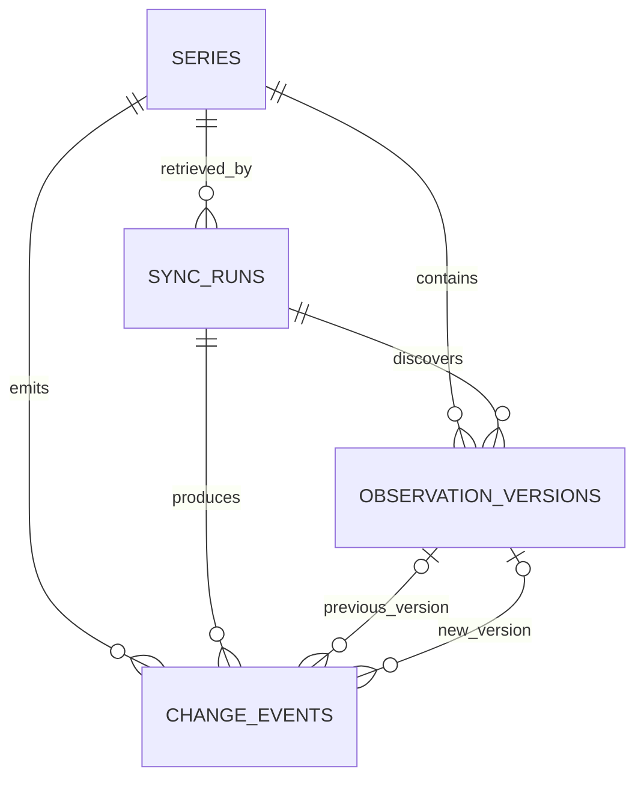

# Database Design and Migrations

## PostgreSQL's role

PostgreSQL is the system of record for research workflow state:

- provider and indicator metadata;
- source retrievals and observation versions;
- dataset recipes and immutable recipe versions;
- build status and exact build inputs;
- transformations and validation results;
- source-to-output lineage;
- export locations, schemas, and checksums;
- users, ownership, jobs, cache records, and audit history.

Large raw responses and generated CSV/Parquet/report files belong in local artifact storage for the MVP and object storage in production. Polars or DuckDB performs analytical transformations. PostgreSQL records what happened and keeps relationships consistent.

## Implemented provider schema

The schema was introduced in Phase 2. Phase 3 now refreshes normalized connector metadata into
`series` idempotently: new provider indicators are created, changed fingerprints update metadata,
and identical fingerprints produce no write.



### `series`

Normalized provider-indicator metadata: provider identity, title, units, frequency, provider metadata, active state, and freshness.

This table will eventually be named or exposed as the provider indicator catalog, but the existing schema does not need to be discarded.

### `sync_runs`

An audit record for one provider retrieval attempt. It records status, timing, result counts, and sanitized failures.

### `observation_versions`

Append-only normalized provider values. Each record includes indicator, period, value or missing state, provider vintage fields, first-observed timestamp, source retrieval, and a deterministic content fingerprint.

Keeping versions allows a future dataset build to reference the exact input it used instead of whatever value happens to be current later.

### `change_events`

Immutable differences between provider input versions. They support source-refresh auditing and later rebuild explanations such as:

```text
Build B differs because 14 provider observations changed after Build A.
```

## Implemented recipe and planning schema

Phase 4 adds:

```text
dataset_recipes
└── recipe_versions
    ├── recipe_variables
    ├── transformation_steps
    └── build_runs
        ├── build_inputs
        └── build_inputs
```

### Dataset recipes and versions

Draft recipes are editable. Recipe versions are immutable and contain the complete validated build definition.

### Build runs and inputs

A build references one recipe version plus the exact provider retrievals or observation versions used. Its deterministic identity prevents duplicate logical builds.

The Phase 4 `build_inputs` records are resolved requests and indicator metadata fingerprints. Exact
retrieved observation-version lineage is added when Phase 5 executes plans and Phase 6 records full
provenance.

Migration `0003` adds the Phase 5 execution boundary to `build_runs`: full result row count, a
bounded JSON preview, and an execution summary containing entity-mapping version and unmatched join
counts. A transformed build advances to `validating`, not `succeeded`; Phase 6 must complete
validation and required exports first.

## Implemented validation, lineage, and export schema

Migration `0004` adds the Phase 6 completion boundary:

```text
build_runs
├── validation_results
├── build_lineage
└── exports
```

It also adds the logical dataset checksum and controlled bundle path to `build_runs`.

### Validation and lineage

Validation records remain queryable rather than existing only in a report file. Lineage links output columns to source indicators and ordered transformations.

### Exports

Export records store format, artifact location, row count, schema, file size, and checksum. The artifact itself is not forced into PostgreSQL.

The service records validation failures without exports. For successful builds it records validation, lineage, every artifact, dataset checksum, bundle path, and the `succeeded` transition in one transaction after the complete bundle exists.

## Implemented authentication and ownership schema

Migrations `0005` through `0012` implement the Phase 7 schema:

```text
users
├── user_sessions
├── audit_events
├── dataset_recipes
└── build_runs
    ├── build_jobs
    └── build_inputs
        └── provider_input_cache
```

`users` stores normalized unique email addresses, salted password hashes, and account state. `user_sessions` stores only a hash of each opaque browser token, plus expiry, revocation, and last-use timestamps. Deleting a user cascades to their sessions.

Every recipe and build has a non-null owner foreign key. Versions and output records inherit access through their recipe or build. Migration `0006` assigns pre-existing local data to an inactive legacy owner so upgrading does not discard work.

Migration `0007` adds a positive attempt number. The combination of recipe version, deterministic plan identity, and attempt number is unique. Attempt 1 is the initial execution; retrying a failed attempt creates attempt 2 or later as a new row with a new artifact directory. Successful and failed rows are terminal, preserving their status, outputs, checksum, validation, and lineage.

Migration `0008` adds one durable job for each build attempt. A worker owns a running job for a limited lease period. The worker updates a heartbeat while it works. An expired lease marks the job and build as failed. The user can then create a new numbered retry.

Migration `0009` permits three attempts for temporary provider failures. Each retry uses a new build row and job row.

Migration `0010` adds job cancellation. A queued job can stop immediately. A running job records a cancellation request. The worker checks that request between major build steps.

Migration `0011` adds immutable provider-input cache entries. Each entry stores the normalized response, request identity, response fingerprint, retrieval time, expiry time, and reuse count. Each build input records the exact cache entry and whether the worker used a hit, miss, or forced refresh.

Migration `0012` adds private audit events. Each event records the user, action, resource type, resource ID, safe details, and time. The audit log covers recipe changes, build actions, worker results, and downloads.

## Existing invariants

### Provider identity

`series(provider, provider_series_id)` is unique.

### Append-only source versions

Every observation version has a unique deterministic fingerprint. Identical content cannot be inserted twice, while a changed value for the same indicator and period becomes a separate version.

### Missing values

```text
is_missing = true  -> value is null
is_missing = false -> value is not null
```

Missing source data is never converted to zero.

### Decimal precision

Provider values use `NUMERIC(30, 10)` in PostgreSQL and `Decimal` in Python.

### Retrieval state

A running retrieval has no finish time. A succeeded or failed retrieval must have one. Classification counts cannot be negative.

## Transaction ownership

Repositories call `flush()` to obtain IDs and enforce constraints but never call `commit()`. Application services own transaction boundaries.

A future successful build will require coordinated short transactions:

```text
freeze recipe version
record resolved input identity
record build state
record completed validation and export metadata
mark build successful only after required artifacts exist
```

External HTTP calls and dataframe work do not hold database transactions open.

## Migration workflow

Apply migrations:

```bash
alembic upgrade head
```

Inspect the active revision:

```bash
alembic current
```

Check ORM/schema drift:

```bash
alembic check
```

Generate reviewable SQL without changing a database:

```bash
alembic upgrade head --sql
```

CI starts an empty PostgreSQL database, applies the migration chain, checks for drift, runs integration tests, downgrades to the base revision, and upgrades again.
