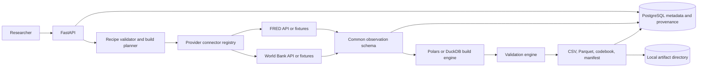
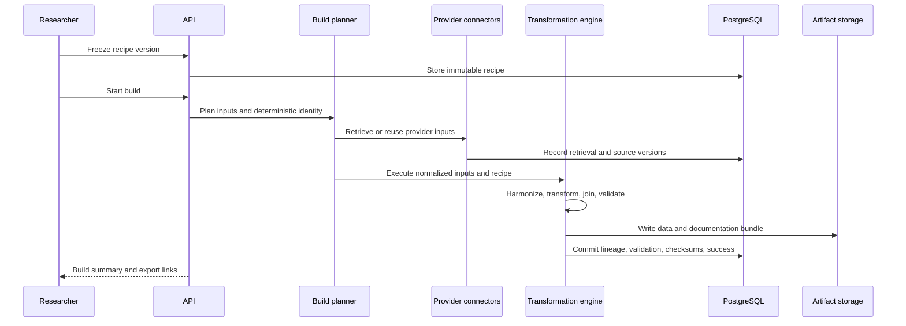
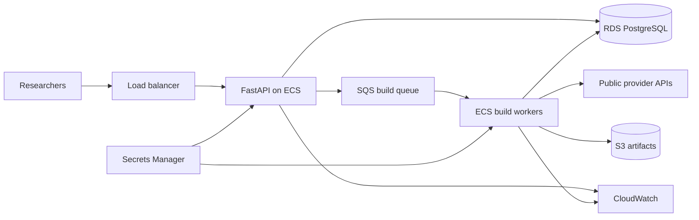

# Research Data Builder System Design

## 1: Requirements

### 1.1 Functional requirements

The system must:

1. Discover indicators from supported public-data providers.
2. Normalize provider metadata and observations into a common schema.
3. Let researchers define and version dataset recipes.
4. Resolve exact provider inputs for a frozen recipe version.
5. Harmonize entities, periods, frequencies, units, and variable names.
6. Apply an explicit deterministic transformation pipeline.
7. Join variables without silently losing unmatched rows.
8. Validate coverage, types, keys, ranges, and recipe-defined rules.
9. Export CSV, Parquet, a codebook, manifest, citations, and validation report.
10. Record source-to-output lineage and deterministic checksums.
11. Rebuild a recipe and explain upstream or output changes.
12. Authenticate users and enforce ownership before public deployment.

### 1.2 Non-functional requirements

| Area | Requirement |
|---|---|
| Correctness | Units, frequency conversions, join rules, and missing-value policies are explicit. |
| Determinism | The same recipe, inputs, and engine version produce identical logical output. |
| Reproducibility | Every export has a frozen recipe, input manifest, lineage, and checksum. |
| Consistency | Build state cannot report success before validation and required artifacts complete. |
| Reliability | Provider failures use bounded retries and do not destroy previously cached inputs. |
| Performance | Transformations operate in bounded batches using Polars or DuckDB. |
| Scalability | API, provider retrieval, build workers, and artifact storage scale independently. |
| Security | Credentials remain external and users cannot access another user's private research. |
| Observability | A build is traceable from API request through retrieval, validation, and export. |
| Testability | Provider fixtures and deterministic recipes make CI independent of live APIs. |

### 1.3 Scope

The local MVP supports FRED and World Bank structured data, saved recipes, deterministic harmonization, validation, and reproducible export bundles.

Authentication, a full web interface, distributed queues, AWS, AI recipe assistance, arbitrary files, and point-in-time backtesting are later phases.

## 2: Core items

### 2.1 Domain objects

#### Provider

Identifies a connector and its capabilities: indicator discovery, entity dimensions, frequencies, pagination, credentials, and source-version information.

#### Indicator

Normalized metadata for a provider variable. The existing `series` table is the first implementation of this concept and stores provider identity, title, units, frequency, metadata, and freshness.

#### Observation version

One normalized provider value with indicator, entity, period, decimal value or missing state, source-version fields, retrieval time, fingerprint, and retrieval run.

The existing append-only model prevents a refreshed provider value from erasing the input used by an older build.

#### Dataset recipe

A named, editable research definition. It specifies variables, entities, period, output frequency, transformations, joins, missing-value policy, validations, and output formats.

#### Recipe version

An immutable snapshot of a validated recipe. Builds always reference a version rather than a mutable draft.

#### Build run

One execution of one recipe version. It records state, deterministic identity, start and finish times, software version, input summary, rows produced, validation result, and failure category.

#### Build input

Links a build to the exact provider retrievals or observation versions used. This is the core provenance record.

#### Transformation step

One ordered deterministic operation with type, parameters, input columns, output columns, and engine version.

#### Validation result

A structured warning or error describing coverage, duplicate keys, missing values, type problems, unmatched joins, or a recipe-defined rule.

#### Export

Metadata for a generated artifact: format, location, schema, row count, size, content checksum, and creation time.

### 2.2 Application components

1. **FastAPI application** — recipe, build, catalog, validation, lineage, and export APIs.
2. **Provider connector registry** — selects FRED or World Bank implementations through one interface.
3. **Provider clients** — handle provider HTTP formats, pagination, rate limits, and errors.
4. **Normalization layer** — converts provider responses into indicator and observation domain objects.
5. **Recipe service** — validates drafts and freezes immutable versions.
6. **Build planner** — resolves required provider requests and deterministic build identity.
7. **Retrieval service** — fetches or reuses suitable provider inputs.
8. **Transformation engine** — executes harmonization, transformations, and joins with Polars or DuckDB.
9. **Validation engine** — produces machine-readable warnings and errors.
10. **Provenance service** — records source-to-output lineage and canonical checksums.
11. **Export service** — writes data and documentation artifacts.
12. **Repository layer** — stores transactional metadata, source versions, builds, and artifact references.
13. **Background worker** — executes queued builds outside API request processes.
14. **Retry policy** — retries temporary provider failures as new numbered build attempts.

### 2.3 Storage responsibilities

| Storage | Responsibility |
|---|---|
| PostgreSQL | Users, provider catalog, recipes, recipe versions, build state, source versions, validation, lineage, and export metadata. |
| Local files in MVP | Raw response fixtures and generated data/documentation bundles. |
| S3 in production | Large raw responses, CSV/Parquet exports, codebooks, and reports. |
| Polars/DuckDB | In-process or local analytical transformation and joins. |
| PostgreSQL job queue | Durable asynchronous build work for the local product. |

PostgreSQL is the system of record for what happened. Parquet and object storage hold large analytical artifacts.

## 3: APIs

Routes are versioned under `/api/v1`. Timestamps use ISO 8601 UTC. Decimal values use strings at JSON boundaries. Collections use bounded cursor pagination.

### 3.1 Authentication

| Method and route | Purpose |
|---|---|
| `POST /api/v1/auth/register` | Create a researcher account and browser session. |
| `POST /api/v1/auth/login` | Verify credentials and create a new browser session. |
| `POST /api/v1/auth/logout` | Revoke the current browser session. |
| `GET /api/v1/auth/me` | Return the active researcher account. |

### 3.2 Provider catalog

| Method and route | Purpose |
|---|---|
| `GET /health` | Report API process liveness. |
| `GET /ready` | Verify required dependencies. |
| `GET /api/v1/providers` | List supported providers and capabilities. |
| `GET /api/v1/providers/{provider_id}/indicators` | Search provider indicators. |
| `GET /api/v1/providers/{provider_id}/indicators/{indicator_id}` | Inspect units, frequency, dimensions, and source metadata. |

### 3.3 Recipes

| Method and route | Purpose |
|---|---|
| `POST /api/v1/recipes` | Create a draft recipe. |
| `GET /api/v1/recipes` | List accessible recipes. |
| `GET /api/v1/recipes/{recipe_id}` | Return the current draft and latest version. |
| `PUT /api/v1/recipes/{recipe_id}/draft` | Replace the validated draft. |
| `POST /api/v1/recipes/{recipe_id}/versions` | Freeze an immutable version. |
| `GET /api/v1/recipes/{recipe_id}/versions` | List recipe history. |
| `GET /api/v1/recipe-versions/{version_id}/export` | Export a frozen version as JSON or YAML. |

### 3.4 Builds and outputs

| Method and route | Purpose |
|---|---|
| `POST /api/v1/recipe-versions/{version_id}/builds` | Start or reuse a deterministic build. |
| `GET /api/v1/builds/{build_id}` | Return state, timing, and summary. |
| `GET /api/v1/builds/{build_id}/preview` | Return a bounded data preview. |
| `POST /api/v1/builds/{build_id}/execute` | Queue a build and return `202 Accepted`. |
| `GET /api/v1/builds/{build_id}/job` | Return queue status, progress, attempts, and errors. |
| `POST /api/v1/builds/{build_id}/retry` | Create a new numbered attempt from a failed build. |
| `GET /api/v1/builds/{build_id}/validation` | Return warnings, errors, and coverage. |
| `GET /api/v1/builds/{build_id}/lineage` | Explain input and transformation lineage. |
| `GET /api/v1/builds/{build_id}/exports` | List generated artifacts and checksums. |
| `GET /api/v1/exports/{export_id}/download` | Download or redirect to an authorized artifact. |
| `GET /api/v1/builds/{build_id}/comparison?other_build_id=...` | Explain recipe, input, and logical dataset changes between builds. |

### 3.5 Example recipe

```json
{
  "name": "european_macro_panel",
  "entities": ["CZE", "DEU", "FRA", "POL"],
  "start_date": "2000-01-01",
  "end_date": "2025-12-31",
  "variables": [
    {
      "provider": "world_bank",
      "indicator": "NY.GDP.MKTP.KD.ZG",
      "output_name": "gdp_growth"
    },
    {
      "provider": "world_bank",
      "indicator": "FP.CPI.TOTL.ZG",
      "output_name": "inflation"
    }
  ],
  "output_frequency": "annual",
  "transformations": [],
  "join": {"keys": ["entity", "period"], "type": "outer"},
  "missing_values": {"policy": "preserve"},
  "formats": ["csv", "parquet"]
}
```

### 3.6 API behavior

- Recipe validation returns structured field and semantic errors.
- Freezing creates a new immutable version and never mutates older versions.
- Build creation accepts an idempotency key and returns a build resource.
- A duplicate deterministic build may return the existing successful resource.
- Previews are bounded and never load arbitrary-sized exports through the API.
- Artifact access requires ownership or explicit sharing after authentication is introduced.

## 4: High-level design

### 4.1 Local MVP architecture



### 4.2 Dataset build flow



### 4.3 Production evolution



The API remains stateless. Build workers scale separately because retrieval and dataframe processing have different resource and latency profiles from ordinary API requests.

## 5: Deep dive into non-functional requirements

### 5.1 Deterministic builds

A build identity derives from the immutable recipe version, exact provider input identities, and transformation-engine version. Display names, request time, and other non-semantic fields do not alter logical identity.

Transformations have stable ordering, explicit parameters, and documented null behavior. Canonical output sorts columns and rows by declared keys before checksum calculation.

### 5.2 Provenance and lineage

Every output variable links to provider, indicator, source unit, retrieval or source version, transformation chain, and final column. Build inputs are immutable references rather than a query that could resolve differently later.

The manifest is useful only if it can answer:

```text
Why is this value here?
Where did it come from?
What changed it?
Can another machine rebuild it?
```

### 5.3 Connector isolation

Provider clients expose normalized metadata and observation objects. Provider-specific pagination, field names, missing markers, and error responses do not leak into recipe or transformation code.

Contract tests run the same behavioral suite against every connector fixture.

### 5.4 Transactions and build states

Provider HTTP calls and dataframe work do not hold database transactions open. Short transactions record state transitions and completed metadata.

A build moves through explicit states such as `planned`, `retrieving`, `transforming`, `validating`, `exporting`, `succeeded`, and `failed`. Required artifacts and provenance must exist before success. Only `planned` can be claimed for execution; `succeeded` and `failed` are terminal. Retrying failure creates a new numbered build record rather than mutating history.

Production uses an outbox or comparable mechanism when a committed state transition must publish queue work.

### 5.5 Idempotency

Provider responses and normalized observations use stable fingerprints. Recipe versions are content-addressable. Logical builds are unique for recipe version, inputs, and engine version.

Retried API calls or queue deliveries may create additional attempts, but not duplicate logical builds or exports.

### 5.6 Harmonization safety

The engine never guesses an ambiguous unit or frequency conversion. Unsupported conversions block the build with an explanation.

Joins report unmatched left and right keys. Missing values remain missing unless the recipe explicitly declares a fill or imputation rule.

Country aliases resolve through a versioned mapping to canonical entity codes. Mapping changes are part of the build identity.

### 5.7 Performance and storage

Provider responses are paginated and normalized in bounded batches. Parquet is the primary analytical artifact. Polars or DuckDB performs joins and transformations without forcing all work into PostgreSQL or the API process.

PostgreSQL stores searchable metadata and moderate source history. Large raw responses and generated artifacts move to object storage. Preview endpoints scan only bounded rows or Parquet metadata.

### 5.8 Security

Credentials come from environment variables locally and a secret manager in production. Provider request logs redact keys. Recipe parameters, entity counts, date ranges, export names, and paths are bounded and validated.

The MVP does not execute arbitrary user code. Public deployment enforces ownership on recipes, builds, source credentials, and artifacts.

### 5.9 Observability

Correlation IDs connect:

```text
request -> recipe version -> build -> provider retrieval
        -> transformation -> validation -> export
```

Metrics cover provider latency and errors, cache reuse, rows retrieved, transformation duration, memory use, missing coverage, validation failures, export size, and build success rate.

### 5.10 Testing strategy

Unit tests cover recipe validation, normalization, transformations, joins, checksums, and validation rules.

Connector contract tests use recorded or hand-authored fixtures for pagination, missing values, malformed responses, rate limits, and provider errors.

PostgreSQL integration tests verify constraints, versioning, transaction rollback, build identity, and lineage queries. End-to-end tests build the same fixture recipe twice and require identical checksums, then modify one source fixture and require a documented difference.

CI does not depend on live provider availability.
