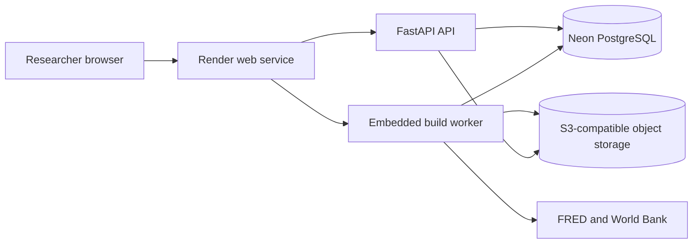

# Zero-Cost Demo Deployment

## Purpose

This setup provides a public portfolio demo without an AWS bill.

The AWS files remain the production reference design. Do not apply the Terraform files for the free demo.

## Design

Render runs the API and worker in one free web service. Neon stores accounts, recipes, jobs, and lineage. Object storage holds export bundles.

This design removes the need for a paid worker service. The application uses the PostgreSQL queue from Phase 7.

## Limits

The free web service sleeps after a period without traffic. The first request after sleep can take more time.

The API and worker share one small service. This design is suitable for a portfolio demo. It is not a high-load production design.

The worker stops when the service sleeps. Durable job state stays in PostgreSQL. A later service start can continue queued work.

The application limits each export bundle and download to 25 MiB. These limits protect memory and free storage quotas.

## Deployment steps

1. Create a free Neon project.
2. Copy its PostgreSQL connection string. The application selects its asynchronous driver automatically.
3. Create a free S3-compatible bucket.
4. Copy the bucket name, endpoint, access key, and secret key.
5. Create a Render Blueprint from this GitHub repository.
6. Enter each secret that `render.yaml` requests.
7. Add a FRED key if you want live FRED builds.
8. Deploy the service.
9. Open `/health` to check the API.
10. Open `/app` to use the product.

Render runs all database migrations before it starts the API.

## Required secrets

| Variable | Source |
|---|---|
| `RESEARCH_DATA_DATABASE_URL` | Neon connection string |
| `RESEARCH_DATA_FRED_API_KEY` | FRED account |
| `RESEARCH_DATA_ARTIFACT_S3_BUCKET` | Object storage provider |
| `RESEARCH_DATA_ARTIFACT_S3_ENDPOINT_URL` | Object storage provider |
| `RESEARCH_DATA_ARTIFACT_S3_ACCESS_KEY_ID` | Object storage provider |
| `RESEARCH_DATA_ARTIFACT_S3_SECRET_ACCESS_KEY` | Object storage provider |

Do not commit these values. Render stores them as private environment variables.

## Object storage choices

The code uses the S3 API. It does not require AWS S3.

You can use a free S3-compatible service. Cloudflare R2 is one option. Neon object storage can also fit this design when available.

The storage layer verifies each SHA-256 checksum before it serves a download. It also rejects files above the configured size limit.

## Production change

For production, use separate API and worker services. Use SQS for worker messages and S3 for artifacts. Use RDS for PostgreSQL.

The AWS Terraform files describe that target design. They also describe private networks, encryption, backups, and failure recovery.
